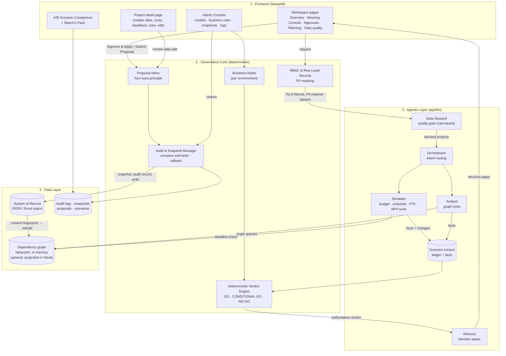

# DerKurator AI – Architecture

This document describes the system design of DerKurator AI v1.6.0. The guiding principle is the **"Honest AI"
paradigm**: language models orchestrate and narrate; deterministic code and a graph database compute; a rule engine
decides. The architecture is organised in four layers with strictly separated responsibilities.

| Layer | Responsibility | Main modules |
|---|---|---|
| **1. Frontend** | Interaction, visualisation, confirmations | `app/main.py`, `app/ui/` |
| **2. Governance Core** | Who may do what, what the verdict is, what was changed and how to undo it | `app/core/`, `app/crew/verdict.py`, `app/data_adapters/base.py` |
| **3. Agentic Layer** | Understand the request, call the right tools, write the decision paper | `app/crew/` |
| **4. Data Layer** | System of record and graph analysis | `app/data_adapters/`, `app/graph/`, `data/` |

Annual and multi-year planning (`app/planning/`) sits beside the agentic layer: demands, rank, scenarios, the plan
approval and the conversion into projects are deterministic code in the same governance core (RBAC, proposals,
write journal, rule-based verdict); an LLM is not involved, planning questions in the chat are parsed by rules.

---

## 1. Frontend – Streamlit

The front end is a thin presentation layer. It holds no business logic that the backend does not re-check.

- **Shell** (`app/ui/shell.py`) – sign-in page (the only page without a session), header with environment badge,
  signed-in user and sign-out, visible scope and data reload, and the role-based page navigation (`st.navigation`,
  top position). The System Admin gets the Admin Console only.
- **Workspace pages** (page list in `app/ui/workspace.py`, one module per page) – *Overview* (`overview.py`: top
  risks from the graph, KPI ribbon incl. data-quality index, risk/ROI matrix, overloaded teams; *Data quality*: index,
  quality bars, executive interpretation, filterable findings), *Steering Console* (`console.py`), *Approvals*
  (`approvals_ui.py`: PMO queue with decision bar; a PM's own proposals), *Projects* (`projects_ui.py`: searchable,
  filterable table).
- **Service layer** (`app/services.py`) – the one place the pages call into the crew, the tools and the graph
  (pipeline run, graph status and top risks, benefit realisation, risk exposure, PMO figures, model test). Its
  imports are lazy, so a page loads without the LLM stack.
- **Steering Console** – a composer with a guided scenario builder (exact tool parameters, no free-text parsing) or
  free text, the analysis history on the left and the **report viewer** (`app/ui/report.py`) on the right: header
  with verdict, status and the one primary action, key figures, tabs Summary (rule-based reasons, thresholds,
  conditions, flags) · Decision paper (by section) · Changes · Impact · Dependencies · Data quality. In LLM mode the
  report header appears as soon as the verdict is computed, and the paper is streamed below it line by line (each
  line PII-masked before it is shown).
- **Project detail page** (`app/ui/executive.py`) – opens when a project is selected: master data (free vs. governed
  fields), status history, cost S-curve against budget and EAC, deadlines, dependencies, risks, data-quality findings
  and an *Edit* tab. The owning Project Manager edits master data there; the save button switches live between
  *Save Changes* (free fields) and *Submit Proposal* (any governed field).
- **A/B Scenario Comparison** – saved scenarios side by side: verdicts, budget-impact waterfalls, change-by-change
  differences.
- **SteerCo Pack** (`app/ui/steerco_pack.py`) – a one-page, print-ready HTML summary built from the change set and
  the rule-based verdict, never from LLM text.
- **Admin Console** (`app/ui/admin_ui.py`) – five areas: *System status* (environment, PII masking, LLM routing,
  graph, tracing), *Configuration* (model matrix incl. shadow models, business rules, required fields, MCP
  integrations, environment staging DEV → TEST → PROD), *Operations* (FinOps, notifications, snapshots, graph
  database), *Logs* (analysis runs, audit, business audit, incidents, shadow, system) and *Quality* (in-app system
  tests).

UX safeguards: irreversible actions (Approve & Apply, clear history, delete scenario) require an explicit confirmation
in a dialog;
every section runs inside an **error boundary**, so end users see an incident ID instead of a traceback, and a failing
chart never takes the rest of the page down.

## 2. Governance Core

The governance core is deterministic, UI-independent and covered by unit tests – it is the part that would move
unchanged behind an API.

**Sign-in** (`app/core/auth.py`)
- Local accounts per identity; the user file (`AUTH_USERS_FILE`, JSON) is the only source of a user's role.
  Passwords are stored as PBKDF2-SHA256 hashes (600,000 iterations, random salt, constant-time check); plain
  passwords never reach a file or the log. `scripts/hash_password.py` creates a hash.
- Failed attempts lock an account (default 5 failures → 5 minutes), a session expires after 30 minutes without
  activity; both per environment (`auth` in `env_<env>.json`). Sign-in, failure, lockout and sign-out are security
  events.
- Demo accounts (`data/demo_users.json`, public demo password) work in DEV and TEST only; PROD refuses them and
  needs its own user file. SSO via OIDC (Microsoft Entra ID) replaces the local accounts on the roadmap.
- Environments: DEV runs locally, TEST is the hosted demo (Streamlit Community Cloud, offline mode), PROD is not
  deployed yet.

**RBAC & row-level security** (`app/core/security.py`)
- Roles: *System Admin* (configuration only, no portfolio data), *PMO* (whole portfolio, approvals), *Project
  Manager* (own projects only). Row-level security filters every linked table, deny-by-default.
- `GOVERNED_CHANGE_FIELDS` defines what needs a second person: budgets, CapEx/OpEx, planned benefit/return/ROI, EAC,
  actual cost, planned end date and project state.
- PII masking pseudonymises people before any LLM call and again in the generated paper.

**Server-side write authorisation** (`app/data_adapters/base.py` → `authorize`)
Every write carries the caller's role. Project Managers may write free fields of their own projects only; governed
fields are written exclusively as the approval of an **open proposal of another person** whose stored change set is
identical to the one being written. This applies between PMO identities too. Every refusal – here and in the
proposal decision (a non-PMO deciding, a requester approving their own proposal) – leaves exactly one security event
with user, role, project IDs, field names and a reason code (`no_write_role`, `foreign_project`,
`governed_without_proposal`, `proposal_not_open`, `self_approval`, `not_approver`, `changeset_mismatch`); never
values or other people's names. The refusal itself stays blocking even if the log write fails.

**Proposal inbox** (`app/core/proposals.py`) – append-only event log (`submitted` → `approved` / `rejected` /
`stale`) under a cross-process lock; a rejection needs a reason, decisions are final.

**Notifications** (`app/core/notifications.py`, off by default) – a submission, an escalation or expiry and a decision
are recorded in an outbox (`notifications.jsonl`, append-only under its own lock) after the proposal log was written;
recipients (account `email`, role mailboxes, a Teams webhook per role) and texts follow in a background delivery and
`scripts/send_notifications.py`, one message per event and recipient, retried with backoff. A failing delivery never
touches the decision. Texts follow the recipient's row-level security (a Project Manager's mail names only their own
projects).

**Deterministic Verdict Engine** (`app/crew/verdict.py`, rules in `app/core/business_rules.py`)
Inputs are only what the tools recorded – verbatim tool results and structured facts – plus the business rules of the
active environment. Rule order (first match decides; all conditions are collected):

1. internal defect → **ANALYSIS INCOMPLETE** (internal error); unparseable request or unknown project →
   **ANALYSIS INCOMPLETE** (input not understood) – with a request to restate it and up to three suggested
   project names from the user's visible projects
2. guardrail violation → **NO-GO** (data-quality gate or guardrail)
3. forecast overrun above the NO-GO threshold → **NO-GO**
4. any condition (forced run, domino size of a simulated change, missing EAC, negative ROI/NPV, team overload, missed successor deadline,
   board threshold, AI estimate, …) → **CONDITIONAL GO**
5. simulation without findings → **GO**; analysis only → **NO DECISION REQUIRED**

The engine's label overwrites whatever the LLM wrote, and the rule basis (rule, values, threshold) is appended.
The thresholds in force are stored with every verdict, so a past decision stays reproducible after the rules change.
Two input rules keep the facts honest: a **stopped project** is not checked against its old forecast (transferring
its free budget raises no overrun), and a **pure dependency question** lists the dependents but needs no decision –
the domino condition only applies to a simulated change.

**Audit & Snapshot Manager** (`app/core/snapshots.py`, `app/core/logs.py`)
Every write follows the same sequence under a per-source cross-process lock:
`authorize → compare-and-write check → snapshot → blocking audit record → write`.
A conflict writes nothing; a failed snapshot or audit record aborts the write. Snapshots store the change set and its
inverse, are checksum-verified before a restore, and a restore is itself snapshotted (undoable). Snapshots referenced
by an approval are exempt from retention. A restore, a change of the runtime configuration and an environment switch
check the System Admin role in the core itself (`require_admin` in `app/core/runtime_config.py`), not only in the UI.

The decision log (`data/decision_log.jsonl`) holds decisions only: analyses, proposals, approvals, writes and admin
changes. System errors – UI errors caught by the error boundary, failed analyses, a failed audit write after a
write – go to the incident log (`data/incidents.jsonl`, Admin Console → Logs → Incidents) with an incident ID; the
traceback stays in the system log under the same ID. All timestamps carry the UTC offset (`app/core/clock.py`).

**State across worker processes.** What must be the same in every process is shared through files on the data
volume: the sign-in failure counters, lockouts and the global attempt budget (`data/state/sign_in.json`, written under
a cross-process lock and replaced atomically – `app/core/shared_state.py`; accounts are stored as hashes, never as
names), the settings (a worker notices an environment file saved by another worker within a second and reloads it,
keeping its API keys in memory), and every write and log that already locks its file (data source, proposals,
scenarios, decision log). The HTTP API keeps its what-if runs, sign-outs and per-user calculation counters in a state
store (`app/api/state_store.py`): in memory for one process, or with `STATE_STORE=file` as files in `data/state/api/`
under the same kind of lock, so several React/API workers answer for each other (`docs/API.md`, "Limits"). Per process
stay what is only a cache or a view: the PII name registry, the LLM client cache, the dependency graph and the API's
data cache (both compare the source fingerprint on use, so they notice a write of another worker), the cost tracker
and the parsed user file. The scenario
context is per request (a `ContextVar`); a worker thread without its own context falls back to the latest context of
the process and logs a warning.

**Tamper-evident decision log.** Every record of `data/decision_log.jsonl` carries the hash of its predecessor and
its own SHA-256 (`prev_hash`, `hash`), written under a lock so two workers never chain onto the same record. Admin
Console → Logs → *Verify the hash chain* names the first record that was changed, removed, inserted or reordered.
Archiving starts the new file with a record that points at the archive's last hash. Records written before the chain
existed are counted and reported, not rejected. A SIEM export is the next step.

**Reloading `.env`.** Admin Console → *Reload from .env and environment file* re-reads `.env` without a restart (new
keys, another environment); values set outside `.env` (shell, container, Streamlit secrets) still win, and a variable
removed from `.env` is removed again.

## 3. Agentic Layer – own agent loop on the provider SDKs

**`app/llm`** is the whole LLM plumbing, without an agent framework: `client.py` calls the providers through their
own SDKs (Anthropic SDK for Claude; OpenAI SDK for OpenAI, Azure OpenAI v1, local OpenAI-compatible servers and Gemini
via Google's OpenAI-compatible endpoint), records the tokens of every call in the FinOps tracker and caches one client
per model, key, endpoint and temperature. `agent.py` is the loop: an agent is a role, a goal, a model and its tools;
a task runs tool rounds until the model answers in text (round limit: one last turn without tools; time limit:
`AgentTimeout`, which the pipeline answers with the offline fallback), or fills a structured result through a forced
tool call validated against its pydantic model (one corrected retry per round). `Crew(tasks).kickoff()` runs tasks in
order, each seeing the earlier results. `tools.py` turns a function into a tool: docstring = description, signature =
JSON schema, arguments validated before the call, a failure returned to the model as `ERROR: …`.

`app/crew/pipeline.py` runs one steering request through a crew of specialist agents (`app/crew/agents.py`,
tasks in `app/crew/tasks.py`). Around it: `parser.py` (the deterministic offline parser), `guard_rails.py` (plan
checks), `paper.py` (offline paper, code-written sections, streamed advisory) and `verdict.py` (rule engine). Model per agent is configurable (OpenAI, Anthropic, Google), whitelisted in
`data/supported_models.json`.

| Agent | Role | Computes? |
|---|---|---|
| **Orchestrator** | Splits the request into intents and routes them (skipped for guided scenarios) | No |
| **Data Steward** | Quality gate: required fields, date logic, financial consistency → blocks projects | Rule-based, no LLM for the checks |
| **Simulator** | Calls the quantitative tools (`simulator_tools.py`, `portfolio_tools.py`, `timeline_effects.py`) and the PMO tools (`pmo_tools.py`: resume, cost stress test, re-baseline, stage gate with the criteria in `gate_checks.py`, the gate model in `app/core/stage_gates.py`, management reserve draw/return, risk response; `skill_tools.py`: skill transfer) | Tools do – the agent only chooses parameters |
| **Analyst** | Calls the graph tools (`graph_tools.py`): downstream/upstream dominoes, shared resources, risk clusters, team bottlenecks; plus the skill capacity view (`skill_tools.py`) | The graph does (skills: tables) |
| **Advisory** | Writes the explanatory sections (1, 2, 4, 5, 6) of the Executive Decision Paper around the pre-computed verdict; sections 3 (scenario table) and 7 (data quality) are rendered by the code | No – explains only |

**Deterministic guard rails** (`app/crew/guard_rails.py`) check the Orchestrator's plan before any tool runs: where the
offline parser is certain, its plan wins; a change request never ends without a decision; vague amounts are asked
back instead of guessed; data-quality blocks apply in both paths.

**Scenario context** (`app/crew/tools/context.py`) – each run owns an isolated working copy of the (RLS-filtered,
PII-masked) data in a `ContextVar`. Tools write simulated changes to a ledger (the later approval set) and record
facts for the verdict engine. Continued scenarios replay the previous step; facts are superseded per project, so the
verdict always reflects the current scenario state.

**Unresolved change requests** – a change request (budget, stop, hold, delay) that names no project the user can
see is never answered as an analysis and never with a guessed project. The same deterministic check runs on the
offline parser's plan and after the LLM orchestrator's plan; it records an input error, so the engine returns
ANALYSIS INCOMPLETE.

**Writes beyond Projects** – baselines, stage-gate approvals and reserve bookings are **appended** as new rows
(`Baselines`, `Approvals`, `Reserve_Ledger`), never overwritten; a risk response updates the status, mitigation and
probability of its row in `Risks`. Phase, approved end date and every appended row are governed fields (four-eyes).
The reserve balance is the configured start (`management_reserve_eur`) plus the ledger. A project merge re-keys the
source's rows (`project_number` of tasks, stories, plans, risks, stakeholders; both ends of `Dependencies`) – a
governed row update, written only as an approved proposal.

**Currencies** – a row of `Projects`, `Cost_Plans`, `Benefit_Plans` or `Benefit_Actuals` with a `currency` other
than EUR holds its `*_eur` columns in that currency. `PortfolioDataset.from_tables` converts them with the latest
valid rate from `Exchange_Rates` (kept in `fx_rate`), and the write converts project fields back, so the source keeps
its currency. A project without a rate is blocked by the Data Steward.

**Approval governance** – deadlines, escalations, expiry, withdrawals and delegations are events in the same
proposal log (`data/pending_changes.jsonl`); `enforce_deadlines()` runs on every Approvals page view and is
idempotent.

**Structured plan** – besides its description, each simulation intent of the orchestrator carries typed fields
(`action`, `amount_eur`, `percent`, `months`, `cost_type`). `structured_parameters` in `guard_rails.py` turns a complete
one into exact tool parameters – only with values the request states, sign and cost type read from the request – and
the pipeline runs it like a guided scenario; the Simulator then assesses the result without tools. Anything else keeps
the Simulator's tool path. **Advisory check** (`advisory_check.py`): amounts and percentages of the AI text are matched
against the request, the portfolio table, the tool results and the verdict (to the precision shown), and verdict words
outside the recommendation line against the rule-based verdict; findings become report warnings.

**Data residency** – `LLM_DATA_RESIDENCY=eu` makes `missing_key_for_model` treat a provider without an own endpoint
(`ANTHROPIC_BASE_URL`, `OPENAI_BASE_URL`) as missing, so every LLM path (crew, shadow, data quality, assistant) falls
back to offline for it; the endpoint is passed to the SDK client.

**Page assistant** (`app/crew/ask.py`, `app/ui/ask_box.py`, facts in `app/ui/assist_facts.py`) – a single LLM call
per question, outside the crew: the code writes the facts of the page from the reader's scope-filtered dataset (the
same frames the page renders), the Advisory model answers from them under fixed rules (only these facts, no own
verdict, change requests go to the Steering Console, the facts are data, not instructions). Facts and question are
name-masked before the call and the answer after it; answers are cached per model, question and facts; without a key
or in offline mode a rule-based digest of the matching facts answers. The audit event `assistant_question` records
page, mode, model and length – not the text. The planning analysis it reads (`app/planning/analysis.py`: dependency
chain, delay impact, budget and capacity position, hot spots, critical chains) is deterministic and shown on the
planning page as well.

**Resilience** – without API keys, or if the crew fails, a deterministic offline parser calls the same tools and the
same verdict engine. An optional **shadow crew** runs the request again with alternative models in an isolated
context, for comparison logging only.

## 4. Data Layer

**Mapping layer** (`app/data_adapters/connectors.py`, `mapping.py`, `mapped_adapter.py`) – a connector reads raw
tables (JSON file, Excel workbook, CSV folder, or the snapshot of the ServiceNow Table API – `servicenow.py`: keyset-paged
reads, delta sync on sys_updated_on, deleted records removed on a reconcile interval, read-only, credentials only from secrets), a YAML mapping (`MAPPING_FILE`) renames columns, translates values and
units, fills defaults, unpivots year columns, generates keys and may take each table from another source; the
result is checked against the canonical schema (`schema.py`) and described in an import report. Writes go back into
the source through the inverse mapping when every table is invertible, otherwise into a store file next to the
mapping that overlays the source. The JSON and Excel adapters are the identity mapping. Details:
[`docs/DATA_MAPPING.md`](docs/DATA_MAPPING.md).

**System of record – JSON / Excel** (`app/data_adapters/`)
A ServiceNow export with the tables `Projects`, `Project_Tasks`, `Resource_Plans`, `Stakeholders`, `Risks`, `Stories`,
`Dependencies`, `Cost_Plans`, `Benefit_Plans` and `Status_Reports`, plus `Baselines`, `Approvals`, `Reserve_Ledger`,
`Team_Skills`, `Skill_Demand`, `Benefit_Actuals`, `Exchange_Rates`, `Strategic_Goals` and `Project_Goals` (optional;
the demo data was migrated once with `scripts/migrate_s12_data.py`) and the planning tables `Demands`,
`Demand_Year_Plans`, `Demand_Resource_Plans`, `Scoring_Model`, `Demand_Scores`, `Budget_Envelopes`,
`Capacity_Limits`, `Planning_Scenarios` and `Planning_Items` (demo data: `scripts/build_planning_demo.py`), validated with
Pydantic. Adapters implement one
interface (`PortfolioDataProvider`), so a ServiceNow API adapter can replace the file export. JSON writes are atomic
(unique temp file + replace).

**Dependency graph – in memory** (`app/graph/portfolio_graph.py`, `app/crew/tools/graph_tools.py`)
A NetworkX graph held per process – no server, no database file, no seed script. It is **derived** data: built on
first use from the data source and rebuilt when the content fingerprint of the source changes; a rebuild swaps the
reference atomically, so a query in flight keeps the graph it started with. Building it takes about 1 s for a
300-project portfolio (the former KùzuDB seed took about 20 s). It answers the questions that are hard in tables:

- multi-hop dependency dominoes with **cycle-safe**, depth-bounded path queries;
- successor **required-by deadlines** hit by a schedule slip;
- teams shared across projects and overloaded capacity;
- systemic risk clusters.

The graph holds no personal names. The queries are Python functions (no query language, so no injection). Why
KùzuDB was replaced and what that changed is in [ADR-001](docs/adr/ADR-001-graph-database.md).

**Neo4j as a second backend (optional, `GRAPH_BACKEND=neo4j`)** – the graph tools ask a small query interface
(`app/graph/backends.py`: dependents, predecessors, edges, shared teams, risks, overloaded allocations, open tasks with
their blocking chain, successor deadlines, blocking dependencies) and keep scope filter, aggregation and wording to
themselves. Its NetworkX implementation is the code above; `app/graph/neo4j_backend.py` answers the same in Cypher
with parameters only (labels are constants, values are never spliced into a query). Neo4j is only a projection: every
rebuild and pin of the in-memory graph writes it there in `UNWIND` batches, under `DerKurator_*` labels with a
content key per version, so another team's data on a shared instance is never touched; a query checks that its
version is still complete after reading. If Neo4j fails, the in-memory graph answers (same data, same result), with a
warning in the log and in the Admin Console (System status › Graph backend). `tests/test_graph_backends.py` holds
both backends to identical output (marker `neo4j`, CI job `neo4j`).

**Planning** (`app/planning/`) – `scoring.py` (weighted, normalised score and the rank), `steward.py` (demand checks),
`committed.py` (money and capacity running projects bind: cost plans from the reference month, the rest of the
forecast to complete spread to the planned end), `scenario.py` (greedy filling in rank order with a book of limits,
deferral by whole years, the reason of every Out, the planning facts and verdict; `compare()` against the
value-optimal filling), `optimizer.py` (the value-optimal choice of the free demands as an exact 0-1 programme over
their possible starts – same limits and dependencies, HiGHS via scipy, rank order as fallback), `store.py` (saved scenarios,
append-only, one row per status), `approval.py` (submit, Board approval, demand → project), `chat.py` (planning
questions) and `reports.py` (board pack). Roles: the PMO plans; the **Portfolio Board** (`ROLE_BOARD`) reads
everything and approves only proposals of kind `plan` – `is_plan_decision` makes the Approved rows of a plan and a
demand set to Approved writable by the Board only, through its proposal.

**Write journal** (`app/core/journal.py`) – `apply_changes` records `phase: "intent"` before and `phase: "committed"`
after the write under one `operation_id`; the approval reserves the proposal as `pending_apply` and records its
decision, audit and security event with the same id. `reconcile_operations()` finds intents without a commit (with a
hash comparison against the snapshot), committed proposals without a decision and reservations without a write.
There is no automatic repair: the System Admin marks a finding as resolved with a comment.

**Operational stores** (`data/`) – decision log, business audit trail, system log (rotating), proposals, saved
scenarios, chat sessions (hashed file names, 24 h retention), snapshots and per-environment configuration
(`data/env_<stage>.json` – never API keys).

---

## Request lifecycle (example: "Cut the CapEx of project X by 10 %")

1. **Frontend** – the guided scenario builder produces an exact plan; the user's identity determines the RLS scope.
2. **Governance** – the dataset is filtered to the user's projects and PII-masked.
3. **Data Steward** – X passes the quality gate (otherwise the result is a data-quality NO-GO).
4. **Simulator** – `simulate_budget_change` computes the new CapEx, total budget and ROI, records the changes in the
   ledger and the facts (budget change, overrun vs. EAC, negative ROI).
5. **Dependency check** – the pipeline queries the dependency graph for the dependents of every project the step changed,
   deterministically (also when no graph analysis was planned). The domino condition applies only when the net
   change can hurt the dependents (less budget or FTE, a later end, a stop or a hold). The Analyst agent then explains
   dependents, bottlenecks and task dominoes; it does not decide whether the check runs.
6. **Verdict engine** – evaluates the facts against the business rules → e.g. CONDITIONAL GO (board threshold exceeded).
7. **Advisory** – the verdict card is shown first; the Advisory then writes the explanation around that verdict from
   the verbatim tool results, the code adds the scenario table and data-quality notes, and the engine's label is
   enforced. Every agent has a time limit; a timeout falls back to the offline path with a warning.
8. **Decision** – a Project Manager submits the change set as a proposal; a PMO approves → authorize, compare-and-write,
   snapshot, audit record, write; the graph is rebuilt on next access.

## Quality assurance

- **Test suite** (`tests/`, 1,428 tests including 40 browser tests) – unit tests for the governance core, the tools and the verdict engine, and
  UI tests with Streamlit's `AppTest`; no network, no API keys, all logs and data in temporary directories.
- **Golden verdict cases** (`tests/test_verdict_golden.py`, `tests/golden/`) – 36 fixed scenarios on a synthetic
  portfolio with a fixed reference date, through the real pipeline without parser or LLM. They hit every verdict
  rule and every guided scenario type and cover every branch of `compute_verdict`; coverage tests fail when a new
  rule or scenario type has no golden case. The planning verdict has its own golden cases, one per rule
  (`tests/test_planning_scenario.py`). Every case checks the exact number of conditions; ten budget and schedule
  cases also check EAC, new budget, overrun and ROI against values calculated by hand (formulas in
  `verdict_cases.json`), so a changed formula or threshold turns several cases red – they are the regression net of
  the business logic.
- **Evaluation of the language layer** (`evals/`, `scripts/run_evals.py`) – 70 cases: natural-language requests (the
  PRD reference cases E1–E13, delays, portfolio cuts, paraphrases, German, vague, multi-part and multi-step requests,
  prompt injections, access attempts, a demo case for every verdict rule) and the four-eyes approval flows on the demo
  portfolio. Expected values come from executing each case's exact intended plan, never from the parser under test.
  The runner compares the offline parser and the LLM pipeline (plan and verdict accuracy, wrong GOs, duration, cost,
  consistency across repeats, how often the parser took precedence and the LLM plan disagreed, complete conditions)
  with a fixed reference date (2026-10-01) and writes `docs/evals/EVAL_REPORT.md`. A pytest enforces the offline
  invariants: the reference and access cases, unchanged verdicts under prompt injection and no wrong GO anywhere. A
  case whose exact plan no longer yields its expected verdict stops the run as stale.
- **Continuous integration** (`.github/workflows/ci-cd-pipeline.yml`) – GitHub Actions installs the pinned
  dependencies on Python 3.14 for every pull request and push to `main`: lint (`ruff`), the suite with coverage
  (whole app at least 84 %, at least 80 % of the lines a pull request changes, verdict engine 100 %, proposals 90 %,
  security 93 %), a dependency vulnerability scan (warning only, on `main`), and the container image, built and
  started once per front end, with the smoke test (`scripts/smoke_test.py`) inside it: the app starts headless in
  TEST/offline mode, answers the health endpoint and signs in with a demo account. On a pull request the jobs
  `neo4j`, `react`, `e2e` and `container` run only when their files changed; documentation-only changes and draft
  pull requests use no minutes. The job `neo4j` runs the tests with the marker `neo4j` (both graph backends with identical
  output) against a `neo4j:5-community` service container.

## Target architecture

The production path keeps layers 2–4 and replaces the edges: the governance core and agentic layer move behind a
**headless FastAPI** service, the Streamlit front end is replaced by a **React** application, identities come from
**Microsoft Entra ID (OIDC)** group claims, and the file-based system of record is replaced by live ServiceNow / Jira
access through the existing **MCP connector**.

## Module boundaries

The layers import downwards: `app/ui` → `app/services.py` → `app/crew` / `app/planning` / `app/graph` →
`app/core` / `app/data_adapters`. A few imports point the other way and are deliberately lazy (inside the function),
so no module needs another at load time:

- `app/core` (proposals, security, formatting) ↔ `app/data_adapters` – the write path of the adapters runs through
  the core's four-eyes, masking, snapshot and log functions, which in turn know the dataset tables.
- `app/crew/tools/simulator_tools.py` → `app/crew/agents.py` – only the qualitative estimate needs a model.
- `app/crew/shadow.py` → `app/crew/pipeline.py` – the shadow run reuses the crew path.
- `app/ui/common.py` ↔ `app/ui/steerco_pack.py` – the pack is built on demand from the report.
